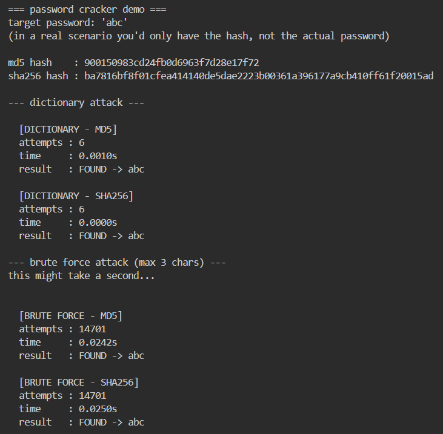

# password cracker - educational

I built this to understand how password hashing actually works and why some algorithms are way worse than others. its not a real cracker obviously, everything runs locally on hashes you make yourself.



---

## what it does

It does two types of attacks :

- **dictionary attack** : takes a wordlist and tries each word until it finds a match
- **brute force** : tries literally every combination possible up to a certain length (gets slow fast)

but also has a bcrypt demo that shows the timing difference between algorithms, that part really surprised me honestly

## How to run it

You need python 3, thats it for the basic version

```bash
git clone https://github.com/your-username/password-cracker.git
cd password-cracker
python cracker.py
```

If you want the bcrypt demo :

```bash
pip install bcrypt
python cracker.py --bcrypt
```

## What i learned

I thought md5 was "broken" in the sense that someone found a bug in it, but that's not really it. the problem is just that its fast and fast hashing is the opposite of what you want for passwords because it means an attacker can try millions of guesses per second.

Bcrypt is slow on purpose, around 100ms per hash by design. doesnt sound like much but it makes brute forcing completely impractical.

The dictionary attack result also surprised me - "abc" shows up as attempt #6 in a 30 word list. real wordlists have millions of entries and cover basically everything a normal person would use as a password.

## files

| file | description |
|------|-------------|
| `cracker.py` | main script |
| `wordlist.txt` | small sample wordlist for the demo |
| `requirements.txt` | just bcrypt, and its optional |

## Future improvements
- no salted hash support (Important in real apps)
- brute force is single threaded so it gets slow above 4-5 chars
- wordlist is tiny, you can replace it with rockyou.txt if you want to test something more realistic
- no sha512 or argon2 support yet