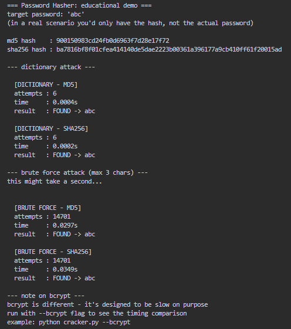
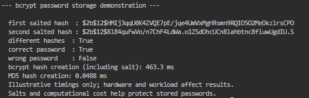
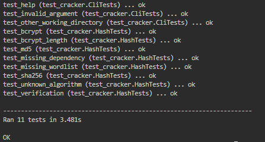
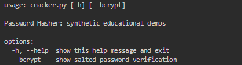

# Password Hasher

Password Hasher is a small Python command-line project that explores how password hashing works and why choosing the right hashing algorithm matters for password security.

## Project objective

The aim of this project is to understand the difference between general-purpose cryptographic hash functions and algorithms designed for password storage. It uses MD5, SHA-256 and bcrypt to demonstrate hashing, password verification, salting and the cost of password guessing in a controlled environment.

The demonstrations use predefined example passwords, locally generated hashes and a small bundled wordlist. No real credentials or external systems are involved.

## Features

- Generate MD5 and SHA-256 hashes from a sample password.
- Demonstrate bounded dictionary and brute-force searches using synthetic data.
- Display the number of attempts, elapsed time and demonstration results.
- Demonstrate bcrypt salting and correct/incorrect password verification.
- Compare illustrative MD5 and bcrypt hash creation times.
- Provide command-line help, error handling and automated tests.

## Technologies

| Technology | Purpose |
|---|---|
| Python 3 | Main programming language |
| `hashlib` | MD5 and SHA-256 hashing |
| `bcrypt` | Salted password hashing and verification |
| `itertools` and `string` | Bounded sample combinations |
| `time` | Elapsed-time measurement |
| `pathlib` | File path handling |
| `argparse` | Command-line argument handling |
| `unittest` | Automated testing |

## Installation

Clone or download the repository and open its folder in a terminal. Make sure Python 3 is installed.

Install bcrypt for the optional password-storage demonstration and the complete test suite:

```bash
python -m pip install -r requirements.txt
```

The default demonstration works with Python's standard library alone. Depending on your system, use `python3` instead of `python` in the commands below.

## Usage and screenshots

### 1. Password hashing demonstration

```bash
python cracker.py
```

The default demonstration generates MD5 and SHA-256 hashes from a predefined sample password and displays the results of two restricted search methods using the project's sample data.



### 2. Bcrypt and password security

```bash
python cracker.py --bcrypt
```

This demonstration generates two salted hashes of the same example password, verifies correct and incorrect passwords, and displays illustrative hash creation times. The random salts explain why identical passwords can produce different stored hashes.



### 3. Automated tests

```bash
python -m unittest -v
```

The test suite contains 11 tests covering known hash values, password verification, invalid algorithms, missing dependencies, bcrypt salting and input length, missing files and command-line behavior. Bcrypt-specific tests are skipped if bcrypt is not installed.



### 4. Command-line help

```bash
python cracker.py --help
```

Displays the available command-line options and usage instructions.



## Project structure

```text
password_hasher/
├── cracker.py
├── test_cracker.py
├── requirements.txt
├── wordlist.txt
├── .gitignore
├── README.md
└── screenshots/
    ├── hashing_demo.png
    ├── bcrypt_demo.png
    ├── automated_tests.png
    └── cli_help.png
```

| File | Purpose |
|---|---|
| `cracker.py` | Main application and educational demonstrations |
| `test_cracker.py` | Automated tests |
| `requirements.txt` | Optional bcrypt dependency |
| `wordlist.txt` | Bundled sample data |
| `.gitignore` | Excludes local and generated files from Git |
| `screenshots/` | Screenshots of the revised application |

## Technical decisions and improvements

The revised version keeps the original single-script structure while improving reliability and readability. File paths are resolved relative to the script, files are managed with context managers, and errors are handled at the command-line entry point. The program uses `time.perf_counter()` for elapsed-time measurements, `argparse` for command-line options and simple type hints to clarify function inputs and outputs.

Bcrypt remains optional so that the basic demonstration can run without external dependencies. Automated tests help check that the main behavior remains consistent after changes.

## Learning objectives

This project provides practice with Python functions, loops, file handling, exceptions, command-line interfaces and unit testing. It also illustrates the distinction between hashing and encryption, deterministic hashes and salted password hashes, and why password storage requires different security properties from general-purpose hashing.

## Security and limitations

MD5 has known collision-resistance weaknesses. Both MD5 and SHA-256 are fast general-purpose hash functions and are unsuitable on their own for password storage. Bcrypt uses random salts and a configurable computational cost to make password guessing more expensive, but weak passwords can still be vulnerable.

The application rejects bcrypt passwords longer than 72 UTF-8 bytes to avoid silent truncation. Timing measurements are illustrative and depend on hardware and workload. The search demonstrations are intentionally restricted and the program is not a production authentication system. Use synthetic data only.

## Future improvements

- Add more tests for edge cases and unexpected input.
- Improve the explanation of password-storage concepts in the terminal output.
- Set up automated test execution with GitHub Actions.

## References

- [Python hashlib documentation](https://docs.python.org/3/library/hashlib.html)
- [Python pathlib documentation](https://docs.python.org/3/library/pathlib.html)
- [Python argparse documentation](https://docs.python.org/3/library/argparse.html)
- [bcrypt documentation](https://github.com/pyca/bcrypt)
- [OWASP Password Storage Cheat Sheet](https://cheatsheetseries.owasp.org/cheatsheets/Password_Storage_Cheat_Sheet.html)
